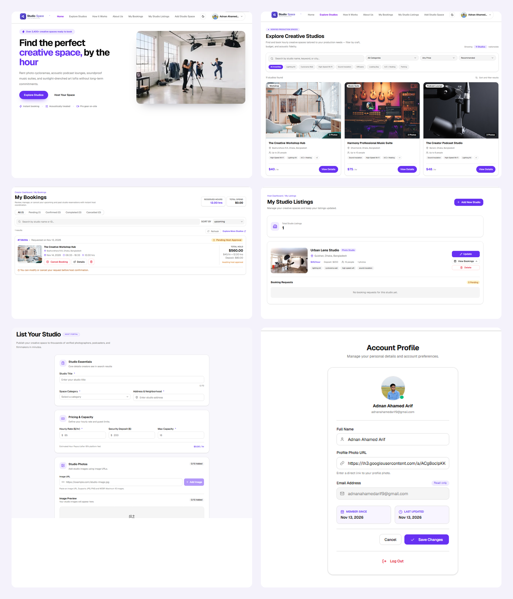
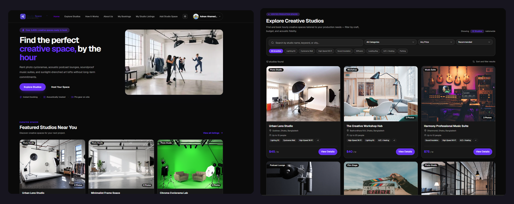

# StudioSpace 🎬

**StudioSpace** is a creative studio booking platform where users can explore, discover, and book creative spaces for photography, filmmaking, podcasting, music production, and other creative projects.

## 🌟 Features

- **Explore Studios:** Browse available creative studios.
- **Search & Filter:** Search studios by name, location, category, price, and amenities.
- **Studio Details:** View studio images, descriptions, facilities, pricing, and capacity.
- **User Authentication:** Register and log in using email or Google.
- **Studio Booking:** Submit booking requests with preferred dates and times.
- **My Bookings:** View and manage personal bookings.
- **Host Dashboard:** Add, edit, and manage studio listings.
- **Booking Management:** Hosts can approve or reject booking requests.
- **Responsive Design:** Works on desktop, tablet, and mobile devices.
- **Dark Mode:** Supports light and dark themes.

## 🛠️ Technologies Used

### Frontend
- Next.js
- React
- TypeScript
- Tailwind CSS
- shadcn/ui
- Lucide React

### Backend
- Node.js
- Express.js
- MongoDB

### Authentication
- Better Auth
- JWT

## 📸 Project Screenshots

## 🔗 Project Links

- **Live Website:** (https://studio-space-beige.vercel.app/)
- **Frontend Repository:** (https://github.com/adnanahamedarif/Studio-Space)
- **Backend Repository:**(https://github.com/adnanahamedarif/Studio-Space-server)

